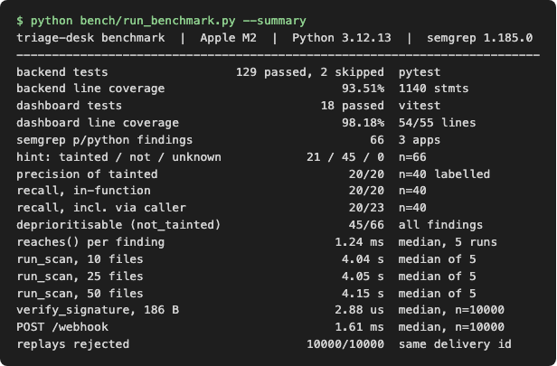
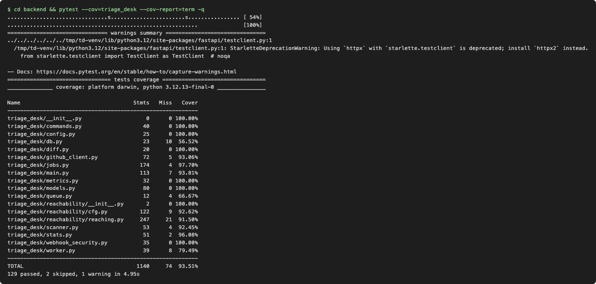
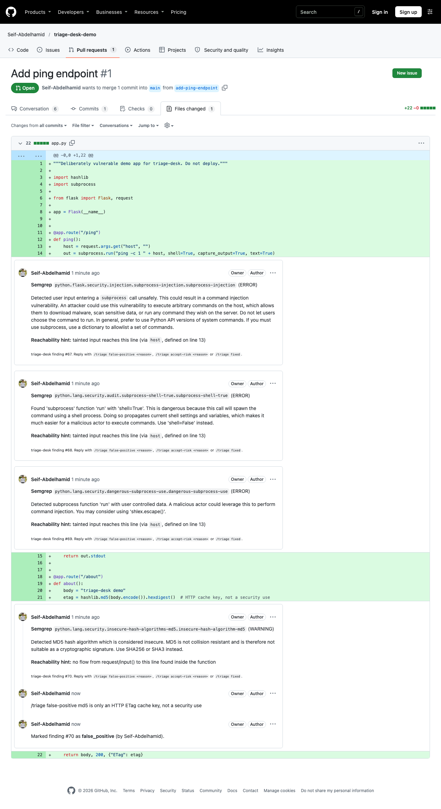
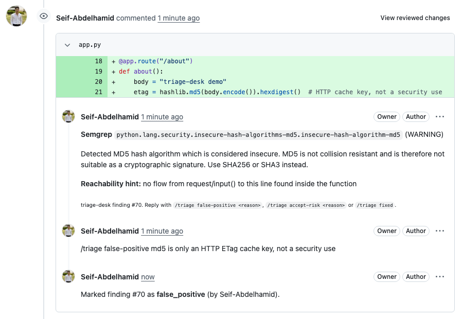
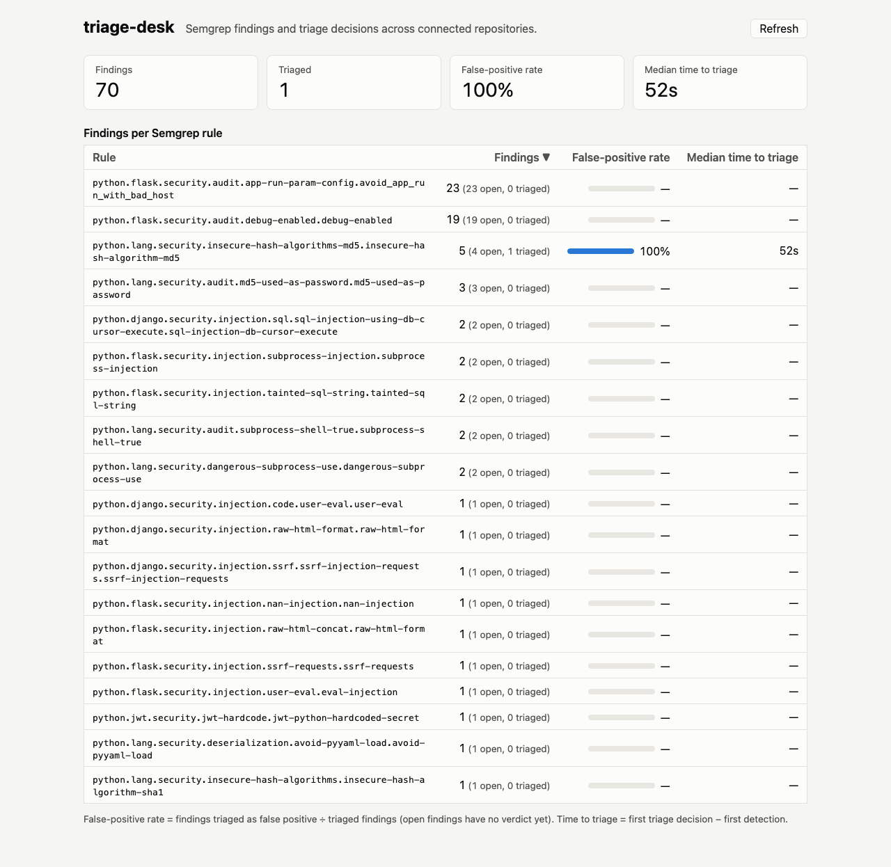
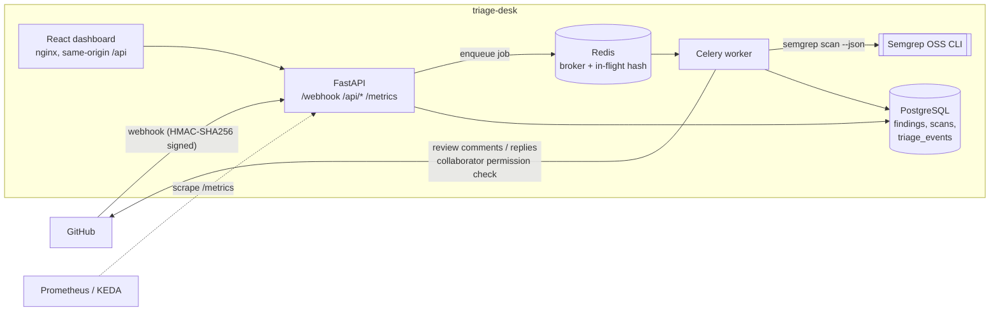

# triage-desk

[](https://github.com/Seif-Abdelhamid/triage-desk/actions/workflows/ci.yml)

A self-hosted GitHub pull-request bot for **Semgrep OSS** findings. When a PR is
opened or updated, it scans the changed files and posts each finding as an
inline review comment. Reviewers triage a finding by replying in its thread:

```
/triage false-positive cmd is validated by parse_args() two lines up
/triage accept-risk internal admin tool, tracked in SEC-142
/triage fixed
```

Only repository collaborators with triage access or higher can triage. Every
decision is written to an append-only audit trail in PostgreSQL, and that
includes denied attempts. A finding marked false-positive or accepted-risk
stays quiet on later pushes. A finding marked fixed that still shows up is
reopened automatically, and the reopen is recorded too.

Python findings also get a **reachability hint** from a small
reaching-definitions analysis. It answers one question: can a value from
`request`, `input()` or `sys.argv` reach the flagged line inside this
function? The hint helps a reviewer decide faster. It is not a verdict.

A React dashboard shows, for each rule, the number of findings, the
false-positive rate and the median time to triage. That makes it easy to spot
noisy rules.

> Status: portfolio project. It runs locally with `docker compose` and has a
> full test suite. It has **not** been deployed for real users, and nothing
> here reports production numbers.

## Results

These numbers come from one run of `python bench/run_benchmark.py` on an Apple
M2 laptop (Python 3.12.13, Semgrep 1.185.0). Three intentionally vulnerable
Python apps were scanned at pinned commits: pygoat, Vulnerable-Flask-App and
dvpwa. Each number comes from a command that was run, not an estimate. For the
method, the 40 hand labels and the limits, see [BENCHMARK.md](BENCHMARK.md).

| Metric | Value | Sample / conditions |
|---|---|---|
| Backend tests | 129 passed, 2 skipped, **93.51 % line coverage** | `pytest --cov=triage_desk`; the skips need PostgreSQL / docker compose |
| Dashboard tests | 18 passed, 98.18 % line coverage | `vitest run --coverage`, all files in `src/` |
| Precision of the `tainted` hint | **100 % (20/20)** | 40 hand-labelled findings (one reviewer), 3 apps |
| Recall of the `tainted` hint | 100 % (20/20) inside the function; **87.0 % (20/23)** counting flows through a caller | same 40 findings |
| Findings a reviewer can deprioritise (`not_tainted`) | **45 of 66 (68.2 %)** | all `p/python` findings on the 3 apps; most are `app.run(debug=True)` lines |
| Scan job end to end (GitHub faked, real Semgrep) | **4.04 s / 4.05 s / 4.15 s** for 10 / 25 / 50 changed files | median of 5 runs; Semgrep start-up is about 4.0 s of it |
| Webhook replay protection | **10,000 of 10,000** replayed delivery IDs rejected; HMAC check 2.88 µs median | 10,000 requests, in-process |

The hint is intraprocedural, and these apps are close to a best case for it.
The numbers may not hold on production code. See the
[limits](BENCHMARK.md#limits).

<table>
<tr><td></td>
<td></td></tr>
</table>

## Live demo

On the public pull request
[Seif-Abdelhamid/triage-desk-demo#1](https://github.com/Seif-Abdelhamid/triage-desk-demo/pull/1),
triage-desk's scan job (`python bench/demo.py scan-pr`) ran locally against
the GitHub API and posted 4 inline review comments. Three are on the
command-injection line, each with the hint "tainted input reaches this line".
The fourth is an MD5 warning with the hint "no flow from request/input() to
this line". A reviewer replied
`/triage false-positive md5 is only an HTTP ETag cache key, not a security use`.
Processing that reply with `python bench/demo.py triage` recorded one audited
`false_positive` decision and posted the bot's confirmation. There is no
hosted bot or webhook here, and the bot and the reviewer use the same GitHub
account.







The dashboard above reads the backend's `/api/stats` from the same database.
It holds the 66 benchmark findings, loaded with
`python bench/demo.py load-bench`, which runs the real scan job with GitHub
faked, plus the 4 findings from the demo PR. Its 100 % false-positive rate and
52 s median time to triage come from **a single** triage decision, so they show
that the metrics work. They say nothing about rule quality.
[Vitest coverage output](docs/images/vitest-coverage.png). The raw logs are in
[`bench/results/logs/`](bench/results/logs).

## Why

Static analysis is only useful if people act on its findings. When a rule is
noisy, developers learn to ignore the bot. Without a record of triage
decisions, nobody can tell which rules are noisy. triage-desk moves triage into
the PR, where the developer already is, and keeps a record of who decided what
and why. That record gives you a per-rule false-positive rate, which tells you
which rules to tune first.

## Architecture



**Flow for a PR event:**

1. `POST /webhook`. The API verifies the signature over the raw body, rejects
   duplicate delivery IDs, and enqueues `scan_pull_request(repo, pr, head_sha)`.
2. The worker lists the PR files, validates each path, and downloads the
   head-commit version of each file into a temporary directory. It then runs
   `semgrep scan --json --metrics=off` on those files only.
3. Each result gets a fingerprint: rule + path + normalised line text +
   occurrence. The fingerprint stays the same when lines shift, so a finding
   is recognised across pushes. The worker upserts the finding, computes the
   reachability hint for `.py` files, and comments only on lines that are part
   of the diff, because GitHub rejects review comments anywhere else.
4. Scans are idempotent per `(repo, PR, head SHA)`, so a retried or replayed
   job does nothing.

**Flow for a `/triage` comment:** the API enqueues `triage_comment`. The worker
then parses the command, works out which finding it refers to (the review
thread, or an explicit `#id`), checks the commenter's repository role, and
applies the decision. It records a `triage_events` row and replies in the
thread.

## Security design and threat model

| Threat | Mitigation | Where |
|---|---|---|
| **Webhook spoofing**: anyone can POST to a public URL | HMAC-SHA256 over the **raw** body with the shared secret, checked against `X-Hub-Signature-256` with `hmac.compare_digest`. Fails closed: no secret configured → 503, missing or malformed header → 401, legacy SHA-1 header not accepted. JSON is parsed only after verification. Body size is capped. | `webhook_security.py`, `main.py` |
| **Replay** of a captured, validly signed delivery | GitHub signatures carry no timestamp, so the API stores every `X-GitHub-Delivery` ID under a primary-key constraint. Two API replicas can't both accept the same ID. IDs are pruned after `REPLAY_WINDOW_S`. A replay after that window would still verify, so the handlers are idempotent as a second layer: scans dedupe on head SHA, triage dedupes on comment ID. | `webhook_security.py`, `jobs.py` |
| **Comment-command injection**: a crafted comment tries to do more than one thing, ping people, inject markdown or HTML, or touch another repository's data | Strict regex grammar on the first line only, with a fixed set of actions. Reasons are length-capped and stripped of control characters, backticks, `<>[]`, `@` and `#`. The reason is stored as a bound SQL parameter and never echoed back. The bot ignores its own comments and all `Bot` accounts, which prevents loops. A `#id` that belongs to a different repository is ignored. | `commands.py`, `jobs.py` |
| **Unauthorised triage**: a drive-by commenter marks a real vulnerability as a false positive | `GET /repos/{repo}/collaborators/{login}/permission` must return `admin`, `maintain`, `write` or `triage`. Read-only users and outsiders are refused, and the attempt is still audited (`allowed = false`). | `github_client.py`, `jobs.py` |
| **Audit tampering** | `triage_events` is append-only. A PostgreSQL trigger rejects `UPDATE` and `DELETE`, so even a bug in the app, or someone with app-level DB credentials, can't rewrite history. The trigger is covered by a test against real PostgreSQL. | `alembic/versions/0001_initial.py`, `tests/test_migrations.py` |
| **Malicious PR content**: path traversal in file names, option injection into the CLI | PR file names are validated: no absolute paths, `..`, empty segments, backslashes or control characters. Files are written only under a fresh temporary directory. Semgrep runs with an argv list (`shell=False`), and every path gets a `./` prefix so a file named `--config=…` can't become a flag. The ruleset comes from configuration, never from the PR. File count, file size and runtime are all capped. | `scanner.py`, `jobs.py` |
| **Token scope**: a leaked bot token | The token needs only *Pull requests: read & write*, *Contents: read* and *Metadata: read*, on the installed repositories only (a fine-grained PAT or a GitHub App installation token). It is never logged. Repository names and logins are validated before they go into API URLs. | `github_client.py`, `.env.example` |
| **Dashboard data exposure**: findings reveal where the weak code is | `docker-compose.yml` binds the dashboard to `127.0.0.1`. nginx proxies only `GET /api/*` and sets a strict CSP. CORS allows only configured origins. The UI renders all finding data as text, and a project Semgrep rule bans `dangerouslySetInnerHTML`. | `dashboard/nginx.conf`, `main.py` |

Out of scope / not built: GitHub App JWT authentication (the bot uses a single
token), per-user dashboard login, and running scans in a separate sandbox
(gVisor/Firecracker). Semgrep only parses code and never executes it, but
untrusted input still goes through a large parser.

## Reachability hint (and its limits)

`triage_desk/reachability/` holds about 550 lines that use only the Python
standard library (`ast`):

1. **CFG.** It builds a statement-level control-flow graph of the innermost
   function containing the flagged line. It handles straight-line code,
   `if/elif/else`, `while`/`for` with back edges, `break`, `continue` and loop
   `else`, and `with`. `try/except/finally` is over-approximated: every
   handler is reachable from every statement in the `try` body.
2. **Reaching definitions.** It runs the classic worklist fixed point,
   `IN[n] = ∪ OUT[pred]` and `OUT[n] = GEN[n] ∪ (IN[n] − KILL[n])`. Only a plain
   assignment to a name *kills* earlier definitions. `x[k] = v`, `x.attr = v`
   and `x.append(v)` are *weak updates* that keep the old definitions alive.
3. **Taint.** A definition is tainted if its right-hand side contains a source
   (`request…`, `input()`, `sys.argv`) or reads a variable whose tainted
   definition reaches that point. This runs to a second fixed point, because
   loop-carried dependencies (`y = x` before `x = request…` in the same loop
   body) need more than one pass.
4. **Labels.** The result is `tainted` (with the variable and the line where it
   was defined), `not_tainted`, or `unknown`.

The tests (`tests/test_reachability.py`) cover reassignment inside a loop that
reaches the sink through the back edge, a loop that runs zero times, `break`
skipping a sanitising assignment, both branches overwriting a value, and more.

**Limits, stated honestly:**

- **Intraprocedural only.** Calls are opaque, and parameters count as
  untainted unless they are named `request`. A helper that receives tainted
  input from its caller is labelled `not_tainted`, and a test pins that
  behaviour.
- Sources are matched by name. There is no type information and no
  import-alias resolution.
- No sanitiser modelling: `int(x)` is still tainted. There is also no alias or
  heap analysis.
- A `match` statement or a syntax error gives `unknown`, rather than a guess.
- `not_tainted` means *no flow was found inside this function*. It does not
  mean the code is safe.

## Data model

```
repositories (id, full_name UNIQUE)
webhook_deliveries (delivery_id PK, event, received_at)        -- replay protection
scans (id, repo_id, pr_number, head_sha, status, files_scanned, error, …)
findings (id, repo_id, fingerprint, rule_id, path, line, severity, message,
          pr_number, first_scan_id, last_scan_id, review_comment_id UNIQUE,
          reachability, reachability_hint, status, created_at, first_triaged_at)
          UNIQUE (repo_id, fingerprint)
triage_events (id, finding_id, repo_id, actor_login, action, reason, allowed,
               previous_status, new_status, github_comment_id, created_at)
          -- append-only (PostgreSQL trigger)
```

`findings.status` holds the *current* state, so the dashboard query stays a
single cheap read. `triage_events` holds the *history*. `first_triaged_at` is
denormalised onto the finding so that median time to triage doesn't need a
join. The false-positive rate is `false_positive ÷ triaged`, not `÷ all
findings`, because an open finding has no verdict yet. A rule with nothing
triaged shows "—", not 0%.

## Metrics and autoscaling

`GET /metrics` exposes `triage_desk_queue_depth`, `triage_desk_inflight_tasks`
and `triage_desk_desired_workers`. Queue depth alone drops to zero as soon as
workers pull tasks, even while they're busy for minutes. A depth-only
autoscaler would scale in mid-scan. See
[docs/adr/0001-inflight-autoscaling-signal.md](docs/adr/0001-inflight-autoscaling-signal.md).

## Setup

### Run the stack

```bash
cp .env.example .env    # set GITHUB_WEBHOOK_SECRET (openssl rand -hex 32), GITHUB_TOKEN, BOT_LOGIN, POSTGRES_PASSWORD
docker compose up --build
# API + webhook: http://localhost:8000   dashboard: http://127.0.0.1:8080
```

Configure a webhook on a test repository:

- **Payload URL:** `https://<your-tunnel>/webhook`. Use a tunnel such as
  `cloudflared` or `ngrok` for local testing.
- **Content type:** `application/json`
- **Secret:** the same `GITHUB_WEBHOOK_SECRET`
- **Events:** *Pull requests*, *Issue comments* and *Pull request review
  comments*

Then open a PR that contains, for example, `subprocess.run(request.args["cmd"], shell=True)`.

### Develop without Docker

```bash
cd backend && python3.12 -m venv .venv && . .venv/bin/activate
pip install -e ".[dev,scan]"
pytest -q                       # SQLite in memory, fake GitHub, fake scanner
ruff check . && mypy triage_desk && bandit -q -r triage_desk

cd ../dashboard && npm ci
npm test && npm run typecheck
npm run dev                     # proxies /api to localhost:8000
```

Optional extra test modes:

- `TEST_DATABASE_URL=postgresql+psycopg://…` runs the whole suite on PostgreSQL.
- `TEST_POSTGRES_URL=…` adds the append-only trigger test.
- `TRIAGE_DESK_E2E=1` runs the compose integration test.

### Tests

| Suite | What | Result in the build sandbox |
|---|---|---|
| backend `pytest` | webhook security, commands, RBAC, scan job, metrics, stats, GitHub client (httpx `MockTransport`), migrations, reachability, and one real `semgrep` run with a local rule | 129 passed, 2 skipped (PostgreSQL trigger test without `TEST_POSTGRES_URL`; docker-compose E2E) |
| backend on PostgreSQL 16 | same suite plus the append-only trigger | 130 passed, 1 skipped (docker-compose E2E) |
| dashboard `vitest` | formatters, rule table (sorting, unknowns, XSS-as-text), App (loading, error, refresh), API client | 18 passed |
| `semgrep --test semgrep-rules/` | the project's own rules | 4/4 passed |

CI (`.github/workflows/ci.yml`) runs ruff, strict mypy, pytest on SQLite and
PostgreSQL, Bandit, `tsc`, Vitest, `vite build`, `npm audit`, and a Semgrep
self-scan. The self-scan uses the project rules plus `p/python`,
`p/typescript`, `p/secrets` and `p/dockerfile`. The registry rulesets could
not be fetched in the sandbox where this was built, so the registry part of
the scan first runs in CI.

## License

MIT. See [LICENSE](LICENSE).
